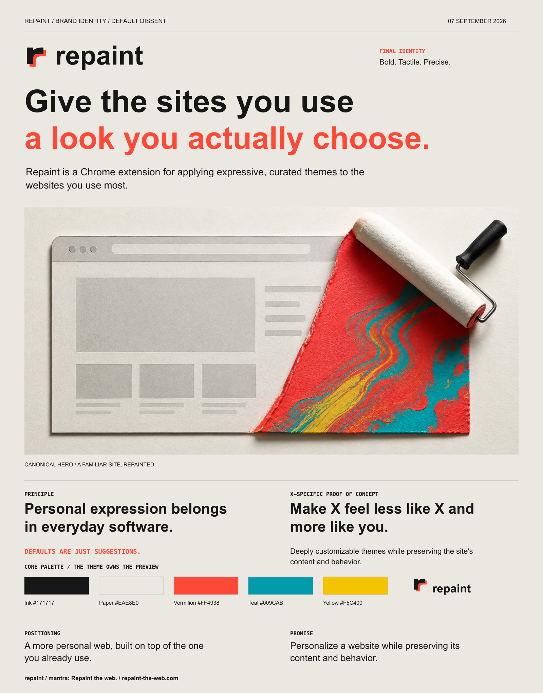
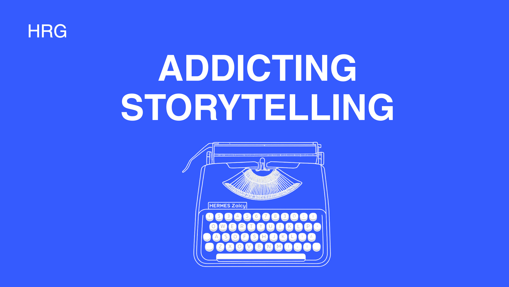

# Personal Skills

Reusable skills for AI coding agents.

## Midjourney Images

[](https://skills.sh/transitive-bullshit/skills)

[`midjourney-images`](skills/midjourney-images/SKILL.md) writes focused Midjourney prompts and can create images in the Midjourney web app. Use it to explore a visual style, build a brand world, or develop concept art.

<p align="center">
  
  
</p>

The skill supports two tasks:

- **Prompt only:** Write or improve a prompt without opening Midjourney.
- **Create on web:** Submit one standard image batch and report the result.

Install it with the Skills CLI:

```sh
npx skills add transitive-bullshit/skills --skill midjourney-images
```

## Branding Exercise

[](https://skills.sh/transitive-bullshit/skills)

[`branding-exercise`](skills/branding-exercise/SKILL.md) develops a project brand through a short context interview, distinct visual identity directions, and iteration. Use it to create a new brand identity or intentionally rebrand an existing project.

<p align="center">
  
</p>

The skill produces:

- **Visual directions:** At least three distinct brand concepts with one-page posters to compare and refine.
- **Accepted identity:** A brand guide, reusable logo and imagery assets, favicons, a social image, and a reproducible one-page poster.
- **Project guidance:** A pointer in the project's agent instructions so future customer-facing work follows the accepted identity.

Install it with the Skills CLI:

```sh
npx skills add transitive-bullshit/skills --skill branding-exercise
```

## Storytelling

[](https://skills.sh/transitive-bullshit/skills)

[`storytelling`](skills/storytelling/SKILL.md) creates and critiques marketing narratives, product or project pitches, and personal stories. Use it to sharpen a hook, clarify emotional stakes, connect story beats, or make an ending land.

This skill is based on work by [Edmund Tian](https://www.instagram.com/edmund.tian).

<p align="center">
  
</p>

The skill supports two tasks:

- **Create:** Draft a narrative around a clear message, causal story beats, and a memorable payoff while preserving your voice and grounding claims in supplied facts.
- **Critique:** Identify the changes that most improve clarity, stakes, credibility, or payoff, with concrete revisions to weak passages.

Install it with the Skills CLI:

```sh
npx skills add transitive-bullshit/skills --skill storytelling
```

## Personal workflows

[`x-data`](skills/x-data/SKILL.md) sets my X lookup order: local Birdclaw → authenticated `bird` → public FxTwitter → paid `xurl`. The archive and API skills and the posting routines follow this shared policy.

[`social-posting`](routines/social-posting/SKILL.md) and [`x-mirror`](routines/x-mirror/SKILL.md) are my own social posting setup: launch game plans and scheduled posts across Threads, Bluesky, LinkedIn, Instagram and TikTok through [Postiz](https://postiz.com), using my X posts as the guide. They live in [`routines/`](routines) because only my scheduled Claude routines use them, so they aren't installed as skills. They're wired to my accounts and here as a reference.

Two more follow my own conventions: [`init-git-repo`](skills/init-git-repo/SKILL.md) sets up a clean, shareable repo the way I like it (audit, baseline files, my TypeScript tooling, docs), and [`personal-notion-projects`](skills/personal-notion-projects/SKILL.md) drafts project write-ups in the Notion CMS behind my site.

## Keep local skills in sync

For a shared setup across Codex and Claude, give your agent this prompt:

```text
Set up transitive-bullshit/skills for my coding agents. Read AGENTS.md,
inspect existing skills, and use the mac profile for a fresh installation.
Preserve existing profiles and local edits, review conflicts before adopting
them, and finish with the doctor check.
```

From the repository, with Python 3.11+:

```sh
python3 scripts/skillset.py apply
python3 scripts/skillset.py doctor
```

This reuses your installed profile (or defaults to `mac`) and symlinks skills into `~/.agents/skills` and `~/.claude/skills`. Edits through either path are Git changes here. Commit and push normally; pull and apply on other machines. Existing files are preserved; conflicts stop installation.

See [setup notes](docs/setup.md) for profiles and adoption, or the [dotfiles repo](https://github.com/transitive-bullshit/dotfiles) for full environment setup and `agent-env` synchronization.

## Upstream skills

[skills.json](skills.json) records every source, pinned revision, license, profile, and local patch. Pristine upstream resources and reconstructable patches live in [provenance/](provenance/); the pre-curation collection is preserved in [history](provenance/history/2026-10-11-before.json).

Run `python3 scripts/upstream.py check` to verify the imported sources plus local patches reproduce the installed skills. See [setup notes](docs/setup.md) for the update workflow.

## License

Personal skills are [MIT](license) by [Travis Fischer](https://x.com/transitive_bs). Third-party skills retain their upstream licenses and attribution; available license files and unresolved provenance are recorded in [skills.json](skills.json).
